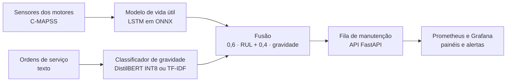

# Manutenção preditiva 4.0

Numa fábrica, saber quanto tempo um motor ainda aguenta e decidir qual ordem de serviço merece atenção primeiro costumam
ser dois problemas separados, tratados por equipes e sistemas diferentes. Este projeto junta os dois e entrega uma fila
única de manutenção, ordenada por urgência, que um planejador abre num painel do Grafana.

## Para que serve

Quem planeja manutenção tem duas fontes de informação que raramente se falam. Os sensores registram temperatura,
pressão e rotação do motor a cada ciclo de uso, e mostram uma degradação lenta. As ordens de serviço trazem o que um
operador viu e ouviu na máquina, escrito com pressa ("vibração acima do normal no compressor, peça HPC-0412").

O sistema lê as duas fontes. Um modelo de séries temporais estima quantos ciclos de vida restam a cada motor. Um
classificador de texto avalia a gravidade de cada ordem e extrai a peça e o sintoma. Uma regra de negócio combina as duas
coisas numa nota de prioridade, e a lista ordenada por essa nota aparece no Grafana. Se os sensores passarem a se
comportar de um jeito diferente do que o modelo viu no treino, ou se o classificador de texto piorar, o sistema levanta
um alerta dizendo que é hora de retreinar.

O desenho serve a qualquer parque de máquinas rotativas, como turbinas, compressores e bombas, em que uma parada fora de
hora custa caro. O projeto foi feito como portfólio, com dados públicos, e não foi testado numa fábrica de verdade.

## Os dados

Os sensores vêm do C-MAPSS, da NASA: simulações de motores turbofan que vão da operação normal até a falha, em quatro
conjuntos (FD001 a FD004) com condições de operação diferentes. São simulações, não motores reais.

Não existe base pública de ordens de serviço em português. Por isso o projeto gera as ordens por templates, a partir do
RUL real de cada motor, com abreviações, erros de digitação, sintomas ambíguos entre gravidades vizinhas e 10% dos rótulos
trocados de propósito. Todo resultado de triagem de texto deste repositório vale para esse corpus sintético e não diz nada
sobre ordens reais.

## Como funciona



Os dados passam por três camadas (bronze, silver e gold). O serviço usa só ONNX Runtime, sem PyTorch, e roda em CPU.
O desenho completo, com o que fica em cada camada e a proposta para rodar o mesmo contêiner num gateway de fábrica, está
em [docs/ARQUITETURA.md](docs/ARQUITETURA.md).

## O que ficou pronto

| Parte | Resultado |
|---|---|
| Vida útil (FD001) | O LSTM erra cerca de 13 ciclos em média. O Random Forest erra 11,96 e a média constante, 40,7. |
| Triagem de ordens | F1-macro de 0,69 com rótulos que têm 10% de ruído. O TF-IDF (0,693) e o DistilBERT (0,690 a 0,696) empatam. |
| Serviço | Imagem de 777 MB. A triagem com DistilBERT leva 33 ms (p95, via HTTP). A API usa 365 MB de RAM. |
| Monitoramento | Dashboard com 9 painéis e 4 alertas (drift de sensores, RUL crítico, drift de classes, queda de F1), todos carregados por arquivo. |
| Qualidade | 112 testes automáticos. O CI roda lint, testes e o build da imagem. |

Dois resultados saíram diferentes do esperado e estão documentados. O LSTM não superou o Random Forest no FD001, depois de
cinco tentativas de melhorá-lo (receitas de treino, janelas maiores, média de modelos, mistura e um modelo híbrido). E o
DistilBERT, treinado numa GPU do Colab, empatou com o TF-IDF, porque o limite de acerto está no desenho do corpus
sintético e não na capacidade do modelo. Os números completos e a discussão estão em
[docs/RESULTADOS.md](docs/RESULTADOS.md).

## Como rodar

Você precisa de [uv](https://docs.astral.sh/uv/), Python 3.12 e, para a parte de contêineres, Docker ou Podman.

1. Baixe o C-MAPSS no NASA Prognostics Data Repository e coloque `train_FD00x.txt`, `test_FD00x.txt` e `RUL_FD00x.txt`
   em `data/raw_download/`. A pasta `data/` não é versionada.
2. Prepare o ambiente e rode o pipeline:

```bash
make install
make reproduce
```

O `make reproduce` roda `make data`, `make train-rul`, `make text` e `make serving`, com seeds fixas. Depois, suba o
sistema e encha os painéis com tráfego simulado:

```bash
make up
make simular
```

O Grafana abre em `http://127.0.0.1:3000` (usuário `admin`, senha `admin` por padrão, trocável por
`GRAFANA_ADMIN_PASSWORD`). Com Podman, use `make up COMPOSE="podman compose"`. O DistilBERT é treinado à parte, no Colab,
com o notebook gerado por `make colab`. Sem ele, a API usa o TF-IDF. No Windows, o `make` precisa ser instalado, ou os
comandos `uv run` do Makefile podem ser rodados à mão.

Para rodar só os testes: `make test`.

## Estrutura

```
src/mp/
  ingest/       bronze: leitura dos arquivos e checksums
  transform/    silver e gold: RUL, normalização, janelas
  textgen/      gerador das ordens de serviço sintéticas
  nlp/          limpeza, NER, Word2Vec e LDA
  models/       LSTM, baselines, classificadores de texto
  api/          serviço FastAPI, métricas Prometheus
  fusion.py     prioridade combinada
  drift.py      PSI e KS
configs/        parâmetros (dados, fusão, gatilhos)
grafana/        fontes, dashboard e alertas versionados
prometheus/     configuração de coleta
docker/         Dockerfile da API
notebooks/      treino do DistilBERT no Colab
docs/           teoria, métricas, arquitetura e resultados
tests/          112 testes
```

## O que não está feito

Três ideias ficaram de fora e talvez entrem depois: detecção de anomalia em imagens (MVTec AD), detecção de anomalia em
áudio de máquinas (MIMII) e resumos gerados por um modelo de linguagem. O áudio sozinho pede arquivos de 7 a 11 GB por
tipo de máquina, o que passa do orçamento de disco do projeto.

Outras limitações:

- O LSTM foi treinado e servido só para o FD001. A comparação com o Random Forest nos conjuntos FD002 a FD004, que têm
  várias condições de operação, ainda não foi feita.
- A fila de manutenção fica em memória, então reiniciar a API a esvazia.
- A imagem foi construída só para amd64, e o desenho para gateway de fábrica não foi testado em hardware.
- Os modelos finais não foram publicados em GitHub Releases e os experimentos não estão em MLflow.
- Word2Vec e LDA existem como código e métricas, mas a API não os usa.

## Documentação

- [README-PROCESSO.md](README-PROCESSO.md): como o projeto foi feito, o que deu errado e o que mudou pelo caminho.
- [docs/RESULTADOS.md](docs/RESULTADOS.md): números, decisões técnicas e verificações.
- [docs/TEORIA_LSTM.md](docs/TEORIA_LSTM.md): como o LSTM funciona, sem cálculo avançado.
- [docs/METRICAS.md](docs/METRICAS.md): RMSE, Score da NASA, F1, PSI, KS e bootstrap.
- [docs/ARQUITETURA.md](docs/ARQUITETURA.md): diagrama do sistema e desenho para borda.

## Fontes

Os dados de sensores vêm do NASA Prognostics Data Repository (C-MAPSS). O classificador de texto parte do modelo
`distilbert-base-multilingual-cased`, do Hugging Face, e o NER usa o `pt_core_news_sm`, do spaCy.
