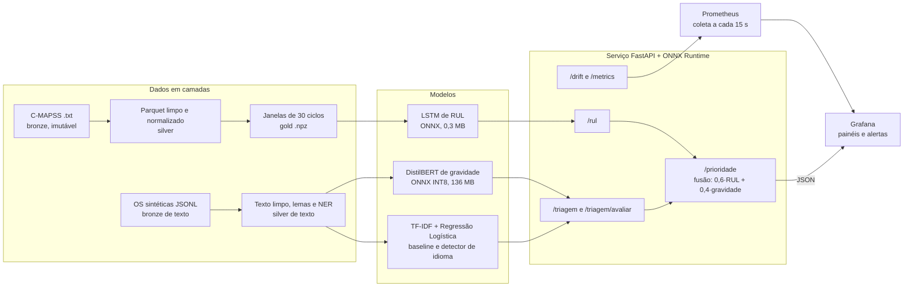
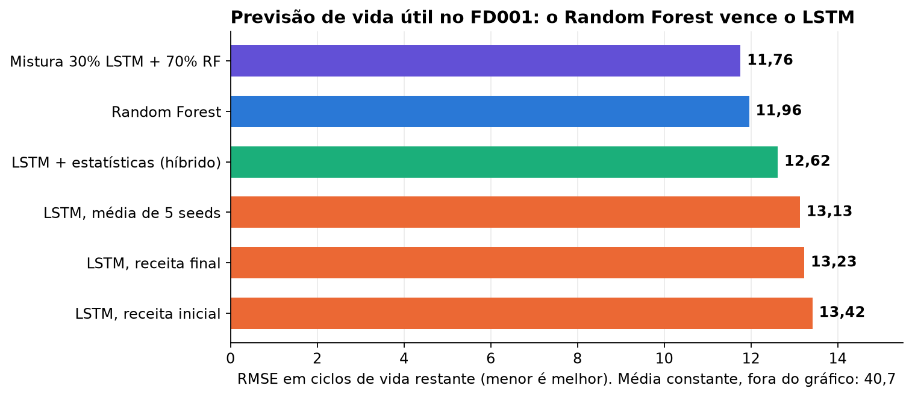
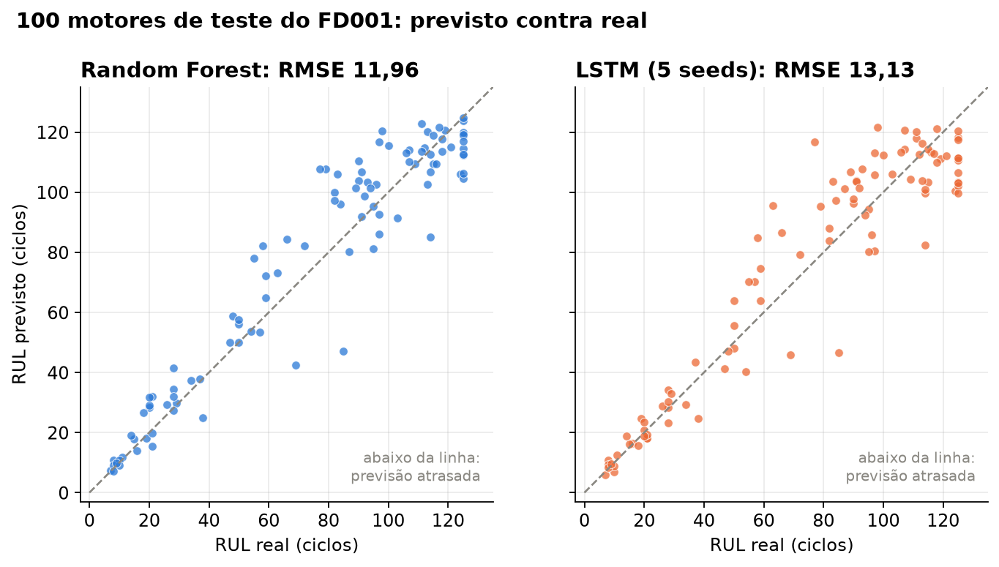
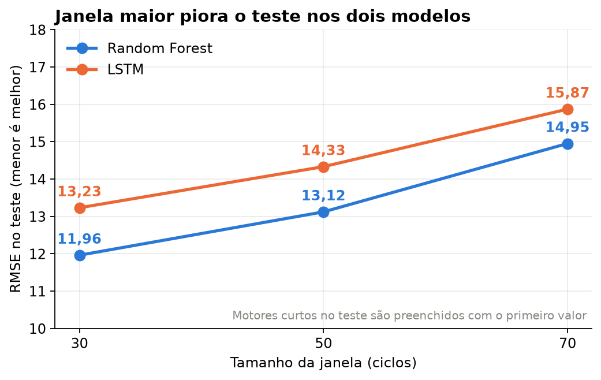
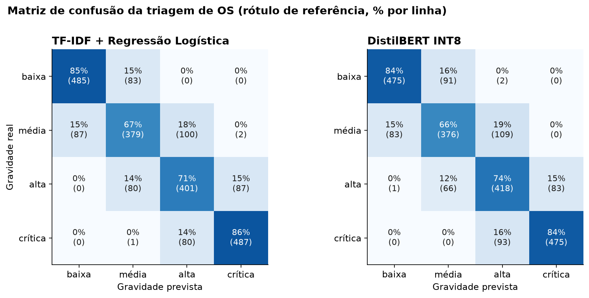
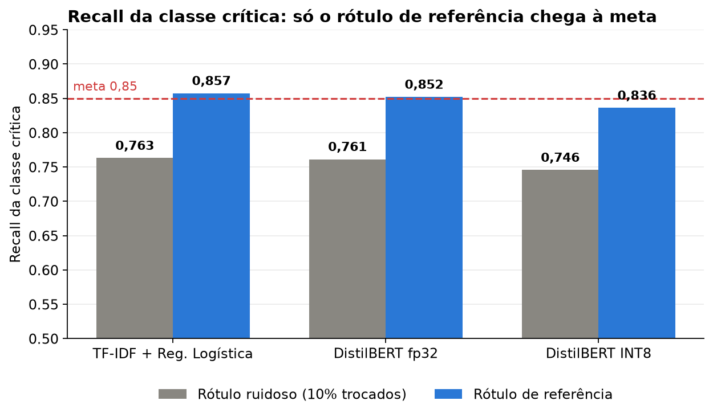
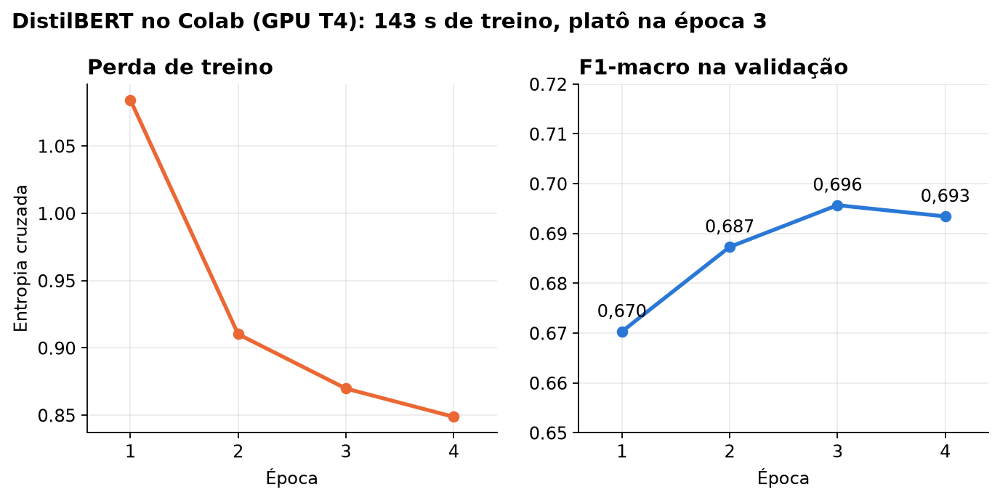
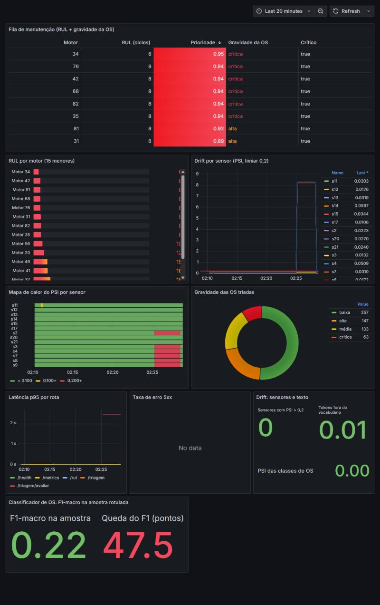
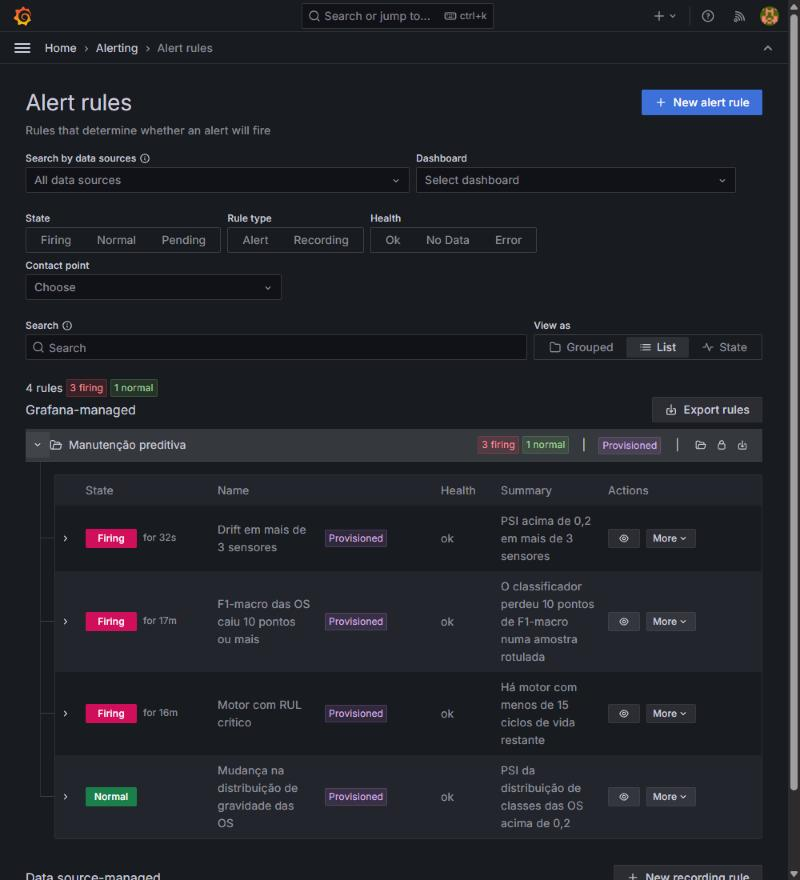
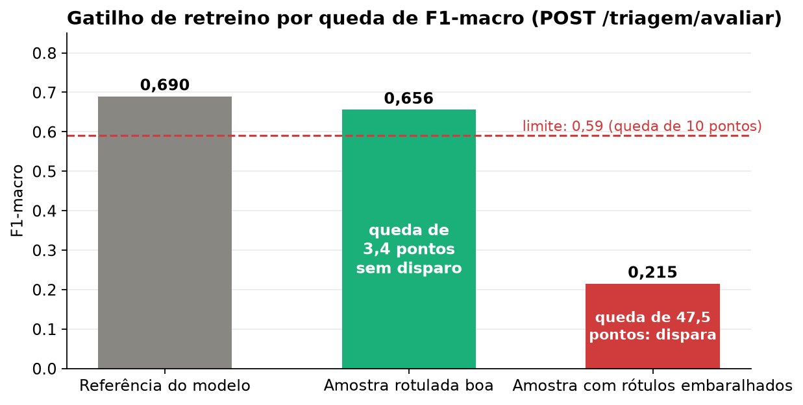

🇧🇷 Português | [🇺🇸 English](README_EN.md)

<div align="center">

# 🔧 Manutenção Preditiva 4.0

### *Uma fila única de manutenção que combina a vida útil restante dos motores (LSTM) com a gravidade das ordens de serviço (PLN)*

[](https://www.python.org/)
[](https://keras.io/)
[](https://scikit-learn.org/)
[](https://spacy.io/)
[](https://onnxruntime.ai/)
[](https://fastapi.tiangolo.com/)
[](https://prometheus.io/)
[](https://grafana.com/)
[](https://www.docker.com/)

**Um sistema de manutenção preditiva construído para estimar quanto tempo cada motor ainda aguenta, entender o que os operadores escrevem nas ordens de serviço e transformar os dois sinais numa lista ordenada de quem atender primeiro, com monitoramento de drift e alertas de retreino.**

</div>

---

## 🌟 Principais Funcionalidades

### 1. 🥉 Arquitetura Medalhão — Bronze → Silver → Gold

Os dados passam por camadas separadas, e as camadas seguintes podem ser reconstruídas sem tocar nos arquivos originais.

* **Bronze:** arquivos originais do **NASA C-MAPSS** copiados byte a byte, com checksum (`MANIFEST.json`). O pipeline falha se algum original mudar.
* **Silver:** **Parquet** com sensores constantes removidos (detectados pela variância no treino), RUL calculado com teto de 125 ciclos e normalização Min-Max ajustada **só no treino** (por grupo de condição de operação no FD002 e no FD004, com K-Means).
* **Gold:** janelas deslizantes de 30 ciclos em `.npz`, com divisão entre treino e validação **por motor** (nunca por linha), para uma janela do mesmo motor não vazar de um lado para o outro.

### 2. 📉 Previsão de Vida Útil com LSTM

Um LSTM de duas camadas (64 e 32 unidades, 33.185 parâmetros) lê a janela de 30 ciclos de 14 sensores e devolve o RUL.

* Baselines obrigatórios ao lado: média constante e **Random Forest** sobre estatísticas da janela.
* Métricas **RMSE** e **Score assimétrico da NASA**, que pune mais a previsão atrasada do que a adiantada ([entenda a diferença](docs/METRICAS.md)).
* Exportação para **ONNX** (0,32 MB), com diferença de 8,4e-5 em relação ao Keras.
* Resultado honesto: no FD001 o Random Forest vence o LSTM, depois de cinco tentativas de melhorá-lo.
* A teoria (estado oculto, pesos compartilhados, BPTT, gradiente que desaparece) está em [docs/TEORIA_LSTM.md](docs/TEORIA_LSTM.md).

### 3. 📝 Triagem de Ordens de Serviço com PLN

Como não existe base pública de ordens de serviço em português, o projeto **gera o corpus** por templates, ligado ao RUL real de cada motor (11.344 OS, com abreviações, erros de digitação, sintomas ambíguos e 10% dos rótulos trocados de propósito).

* **NER** por regras (spaCy `EntityRuler`): código de peça (`HPC-0412`) em 100% das ordens, mais componente e sintoma.
* Classificação de gravidade em quatro níveis: baixa, média, alta e crítica.
* Modelos: **TF-IDF + Regressão Logística** (baseline), **DistilBERT multilíngue** treinado no Colab e exportado em **ONNX INT8** (135,7 MB), **Word2Vec** para ordens parecidas e **LDA** para tópicos.
* Casos de borda: OS vazia, só com código de peça ou em outro idioma devolve `gravidade=indefinida` e vai para revisão humana.

### 4. 🔀 Fusão e Fila de Manutenção

Uma regra de negócio, com pesos em `configs/fusion.yaml`, combina os dois módulos numa nota de prioridade de 0 a 1:

```
prioridade = 0,6 · (1 − min(RUL, 125) / 125) + 0,4 · P(gravidade ∈ {alta, crítica})
```

A fila ordenada por essa nota é o que aparece no painel. Não é um modelo treinado, e isso está dito na documentação.

### 5. 🚀 Serviço de Inferência — FastAPI + ONNX Runtime

* Endpoints: `/rul`, `/triagem`, `/triagem/avaliar`, `/prioridade`, `/drift`, `/metrics` e `/health`.
* Imagem Docker de **777 MB**, sem PyTorch, rodando em CPU. A triagem com DistilBERT leva **33 ms** (p95, via HTTP) e a API usa **365 MB** de RAM.
* Entrada inválida devolve `422`. Motor com menos de 30 ciclos devolve `low_confidence=true`, e condição de operação nunca vista é sinalizada em vez de prevista em silêncio.

### 6. 📊 Monitoramento, Drift e Alertas — Prometheus + Grafana

* O **Grafana é provisionado por arquivo**: fontes, dashboard (9 painéis) e **4 alertas** ficam no repositório, sem configuração pela interface.
* **Drift dos sensores:** PSI contra uma amostra do treino. O gatilho é PSI acima de 0,2 em **mais de 3 sensores**.
* **Drift do texto:** taxa de palavras fora do vocabulário e PSI da distribuição de gravidade.
* **Gatilho de retreino:** `POST /triagem/avaliar` recebe OS com a gravidade real e dispara quando o F1-macro cai **10 pontos ou mais** em relação ao do treino.
* As métricas só usam rótulos `unit_id`, `sensor` e `gravidade`, nunca texto de OS.

### 7. 🧪 Testes Automatizados e CI

* **112 testes** automáticos: lógica de dados, ausência de vazamento entre treino e validação, contrato da API (respostas `422`), casos de borda, métricas, gatilhos de drift e de F1, e o pipeline do DistilBERT com um modelo minúsculo.
* Testes que conferem os arquivos do Grafana contra as métricas que a API expõe e que todo comando `make` citado na documentação existe.
* **GitHub Actions** com `ruff`, `pytest` e build da imagem Docker.

---

## 🏗️ Arquitetura

O sistema tem dois módulos independentes que se encontram na fusão. O serviço carrega só modelos ONNX e expõe métricas ao Prometheus, e o Grafana lê as métricas e a fila de prioridade.



O fluxo principal pode ser resumido como:

**Sensores + Ordens de serviço → Modelos (ONNX) → Fusão → Fila de prioridade → Grafana**

Há também um desenho para rodar o mesmo contêiner num gateway dentro da fábrica, descrito como proposta (não testado em hardware) em [docs/ARQUITETURA.md](docs/ARQUITETURA.md).

---

## 📊 Resultados

Todos os gráficos abaixo são gerados por `make graficos` a partir dos arquivos em [`docs/resultados/`](docs/resultados/).

### Vida útil dos motores (FD001)

<div align="center">



<p><em>O Random Forest (11,96) vence o LSTM (13,13 a 13,42). A média constante erra 40,7 e ficou fora do gráfico.</em></p>

</div>

<div align="center">



<p><em>Previsto contra real nos 100 motores de teste. Os dois modelos acompanham a diagonal; o LSTM espalha mais nos motores saudáveis.</em></p>

</div>

<div align="center">



<p><em>Janelas maiores pioram o teste nos dois modelos, porque motores curtos são preenchidos com o primeiro valor.</em></p>

</div>

### Triagem de ordens de serviço

<div align="center">



<p><em>Os erros se concentram entre gravidades vizinhas. As classes baixa e crítica quase nunca se confundem.</em></p>

</div>

<div align="center">



<p><em>O DistilBERT empata com o TF-IDF neste corpus sintético. A meta de 0,85 só é atingida no rótulo de referência.</em></p>

</div>

<div align="center">



<p><em>DistilBERT treinado numa GPU T4 do Colab em 143 segundos, com platô na terceira época.</em></p>

</div>

| Modelo | F1-macro (ruidoso) | F1-macro (referência) | Recall da crítica (ruidoso) | Recall da crítica (referência) |
|---|---|---|---|---|
| TF-IDF + Regressão Logística | 0,693 | 0,771 | 0,763 | 0,857 |
| DistilBERT fp32 | 0,696 | 0,773 | 0,761 | 0,852 |
| DistilBERT INT8 (usado no serviço) | 0,690 | 0,768 | 0,746 | 0,836 |

### Monitoramento no Grafana

<div align="center">



<p><em>Dashboard depois de um episódio de drift forçado: o pico de PSI aparece no histórico e o mapa de calor mostra os 6 sensores deslocados em vermelho. A fila no topo ordena os motores por prioridade.</em></p>

</div>

<div align="center">



<p><em>Os alertas carregados por arquivo: durante o incidente, drift de sensores, RUL crítico e queda de F1 dispararam ao mesmo tempo.</em></p>

</div>

<div align="center">



<p><em>O gatilho de retreino medido no contêiner: amostra boa com queda de 3,4 pontos (sem disparo) e amostra com rótulos embaralhados com queda de 47,5 pontos (dispara).</em></p>

</div>

Os números completos, as decisões técnicas e o que foi verificado em cada etapa estão em [docs/RESULTADOS.md](docs/RESULTADOS.md).

---

## ⚡ Quickstart

### 1. Preparar o Ambiente

O projeto usa [`uv`](https://github.com/astral-sh/uv) e Python 3.12. O `make` facilita, mas os comandos `uv run` do `Makefile` também funcionam à mão.

```bash
git clone https://github.com/samuelmel/manutencao-preditiva-.git
cd manutencao-preditiva-

make install
```

Ou sem `make`:

```bash
uv venv --python 3.12 .venv
uv pip install --python .venv -e ".[dev,train,nlp,serve,bert,docs]"
```

### 2. Baixar os Dados

Baixe o C-MAPSS da NASA ([CMAPSSData.zip](https://data.nasa.gov/docs/legacy/CMAPSSData.zip)) e copie os arquivos `train_FD00x.txt`, `test_FD00x.txt` e `RUL_FD00x.txt` para `data/raw_download/`. A pasta `data/` não é versionada.

### 3. Rodar o Pipeline Completo

```bash
make reproduce
```

O comando encadeia `make data` (bronze, silver e gold), `make train-rul` (baselines e LSTM, exporta o ONNX), `make text` (gera as ordens, NER, TF-IDF, Word2Vec e LDA) e `make serving` (reúne os artefatos que a API carrega). As seeds são fixas.

O DistilBERT é treinado à parte, no Colab: `make colab` gera um zip de 1,2 MB e o notebook `notebooks/treinar_distilbert.ipynb`. Sem ele, a API usa o TF-IDF.

### 4. Subir a Infraestrutura

```bash
make up                                  # Docker
make up COMPOSE="podman compose"         # Podman
```

Após a inicialização:

* **API (documentação interativa):** `http://127.0.0.1:8000/docs`
* **Prometheus:** `http://127.0.0.1:9090`
* **Grafana:** `http://127.0.0.1:3000`

Credenciais padrão do ambiente local:

```text
Grafana
Usuário: admin
Senha: admin    (troque com a variável GRAFANA_ADMIN_PASSWORD)
```

> As portas ficam presas em `127.0.0.1` e a senha acima é só para desenvolvimento local. Na primeira vez, o Grafana leva alguns minutos para migrar o banco e baixar o plugin Infinity.

### 5. Encher os Painéis com Tráfego Simulado

```bash
make simular                              # 100 motores de teste e uma OS para cada
uv run python -m mp.simular --drift       # desloca 6 sensores e dispara o alerta de drift
uv run python -m mp.simular --f1-degradado  # amostra rotulada com rótulos embaralhados
```

---

## 💻 Exemplos de Uso da API

### Triagem de uma ordem de serviço

> No Windows, o `curl` do Git Bash pode estragar acentos no corpo da requisição e a API responde `400`. Use PowerShell, Python ou a interface em `/docs`.

```bash
curl -X POST http://127.0.0.1:8000/triagem \
  -H "Content-Type: application/json; charset=utf-8" \
  -d '{"texto": "Motor 5: falha total em compressor de alta (HPC-0412), fumaça visível.", "unit_id": 5}'
```

```json
{
  "entidades": {
    "codigo": "HPC-0412",
    "componente": "compressor de alta",
    "sintoma": "fumaça visível"
  },
  "texto_limpo": "motor 5: falha total em compressor de alta (hpc-0412), fumaça visível.",
  "gravidade": "crítica",
  "motivo": null,
  "probabilidades": { "baixa": 0.034, "média": 0.022, "alta": 0.183, "crítica": 0.76 },
  "p_grave": 0.944,
  "revisao_humana": false
}
```

Um texto em outro idioma, vazio ou só com código de peça não é classificado:

```json
{ "gravidade": "indefinida", "motivo": "vocabulário desconhecido", "p_grave": null, "revisao_humana": true }
```

### Fila de manutenção

```bash
curl "http://127.0.0.1:8000/prioridade?top=3"
```

```json
{
  "itens": [
    { "unit_id": 34, "rul": 5.7, "p_grave": 0.936, "gravidade_os": "crítica", "prioridade": 0.947, "critico": true },
    { "unit_id": 76, "rul": 7.7, "p_grave": 0.945, "gravidade_os": "crítica", "prioridade": 0.941, "critico": true },
    { "unit_id": 42, "rul": 7.6, "p_grave": 0.94,  "gravidade_os": "crítica", "prioridade": 0.94,  "critico": true }
  ]
}
```

### Gatilho de retreino do classificador

Envie ordens com a gravidade real e a API compara o F1-macro com o de referência do modelo:

```bash
curl -X POST http://127.0.0.1:8000/triagem/avaliar \
  -H "Content-Type: application/json; charset=utf-8" \
  -d '{"itens": [{"texto": "Operador relata travamento do eixo em turbina de alta, peça HPT-0185.", "gravidade": "crítica"}, ...]}'
```

```json
{
  "n_amostra": 300, "n_avaliadas": 300, "n_indefinidas": 0,
  "f1_macro": 0.656, "f1_macro_ref": 0.69, "queda_pontos": 3.399, "limite_pontos": 10,
  "amostra_pequena": false, "gatilho_retreino": false
}
```

### Vida útil de um motor

`POST /rul` recebe o `unit_id` e a lista de ciclos (cada ciclo é um objeto com `op1`, `op2`, `op3` e os 14 sensores). Com menos de 30 ciclos a resposta traz `low_confidence=true`, e um RUL negativo é limitado a zero.

---

## 💻 Exemplo de Código — Fusão e PSI

A fusão fica em `src/mp/fusion.py` e é uma função pura, fácil de testar:

```python
def prioridade(rul: float, p_grave: float | None, w_rul: float = 0.6, w_os: float = 0.4,
               rul_cap: float = 125.0) -> float:
    """Em [0, 1]. Sem OS conhecida (`p_grave=None`) a parcela da OS vale 0."""
    rul = min(max(float(rul), 0.0), rul_cap)
    parcela_os = 0.0 if p_grave is None else min(max(float(p_grave), 0.0), 1.0)
    return w_rul * (1.0 - rul / rul_cap) + w_os * parcela_os
```

O drift dos sensores usa o PSI, com faixas por quantis da referência (`src/mp/drift.py`, aqui em versão resumida):

```python
def psi(ref: np.ndarray, atual: np.ndarray, bins: int = 10) -> float:
    """Population Stability Index com faixas por quantis da referência."""
    ref, atual = np.asarray(ref, dtype=float), np.asarray(atual, dtype=float)
    edges = np.unique(np.quantile(ref, np.linspace(0, 1, bins + 1)))
    if len(edges) < 3:  # sensor praticamente constante na referência
        return 0.0 if np.allclose(atual, ref[0]) else float("inf")
    edges[0], edges[-1] = -np.inf, np.inf
    p = np.histogram(ref, edges)[0] / len(ref)
    q = np.histogram(atual, edges)[0] / len(atual)
    p, q = np.clip(p, 1e-4, None), np.clip(q, 1e-4, None)
    return float(np.sum((q - p) * np.log(q / p)))
```

---

## 🧪 Testes Automatizados

```bash
make test
```

Ou diretamente:

```bash
uv run pytest -q
```

Os testes que usam os artefatos reais (RMSE pela API, latência, DistilBERT) são pulados se `make reproduce` ainda não rodou.

---

## 🗂️ Estrutura do Repositório

```
src/mp/
  ingest/       bronze: leitura dos arquivos e checksums
  transform/    silver e gold: RUL, normalização, janelas
  textgen/      gerador das ordens de serviço sintéticas
  nlp/          limpeza, NER, Word2Vec e LDA
  models/       LSTM, baselines, classificadores de texto
  api/          serviço FastAPI e métricas Prometheus
  fusion.py     prioridade combinada
  drift.py      PSI e KS
configs/        parâmetros (dados, fusão, gatilhos)
grafana/        fontes, dashboard e alertas versionados
prometheus/     configuração de coleta
docker/         Dockerfile da API
notebooks/      treino do DistilBERT no Colab
scripts/        geração de gráficos, dashboard e pacote do Colab
docs/           teoria, métricas, arquitetura e resultados
img/            gráficos e capturas do Grafana
tests/          112 testes
```

---

## 📚 Documentação

* [README-PROCESSO.md](README-PROCESSO.md): como o projeto foi feito, o que deu errado e o que mudou pelo caminho.
* [docs/RESULTADOS.md](docs/RESULTADOS.md): números, decisões técnicas e verificações.
* [docs/TEORIA_LSTM.md](docs/TEORIA_LSTM.md): como o LSTM funciona, sem cálculo avançado.
* [docs/METRICAS.md](docs/METRICAS.md): RMSE, Score da NASA, F1, PSI, KS e bootstrap.
* [docs/ARQUITETURA.md](docs/ARQUITETURA.md): diagrama do sistema e desenho para borda.

## 🚧 Limitações e Próximos Passos

* O texto das ordens é **sintético**. Nenhum resultado de triagem vale como evidência sobre ordens reais, e só ordens reais poderiam mostrar se o DistilBERT compensa o custo sobre o TF-IDF.
* O LSTM foi treinado e servido só para o **FD001**. A comparação com o Random Forest nos conjuntos FD002 a FD004, que têm várias condições de operação, ainda não foi feita.
* A fila de manutenção fica em memória na API, então reiniciar a API a esvazia.
* A imagem foi construída só para amd64, e o desenho para gateway de fábrica não foi testado em hardware.
* Os modelos finais não foram publicados em GitHub Releases, e os experimentos não estão em MLflow.
* **Talvez no futuro:** detecção de anomalia em imagens (MVTec AD), em áudio de máquinas (MIMII) e resumos gerados por modelo de linguagem. O áudio sozinho pede arquivos de 7 a 11 GB por tipo de máquina, o que passa do orçamento de disco do projeto.

---

**Samuel Santos**

Este projeto foi desenvolvido como **portfólio técnico e projeto de estudo**, com foco em Engenharia de Dados, MLOps, arquiteturas de inferência em CPU e monitoramento de modelos em produção.

Os dados de sensores vêm do NASA Prognostics Data Repository (C-MAPSS). O classificador de texto parte do modelo `distilbert-base-multilingual-cased`, do Hugging Face, e o NER usa o `pt_core_news_sm`, do spaCy.

---

🇧🇷 Português | [🇺🇸 English](README_EN.md)
