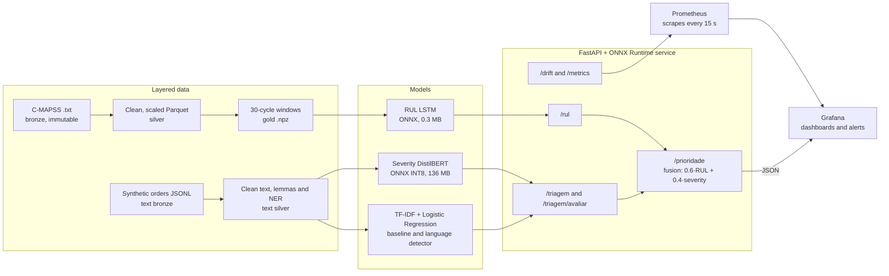
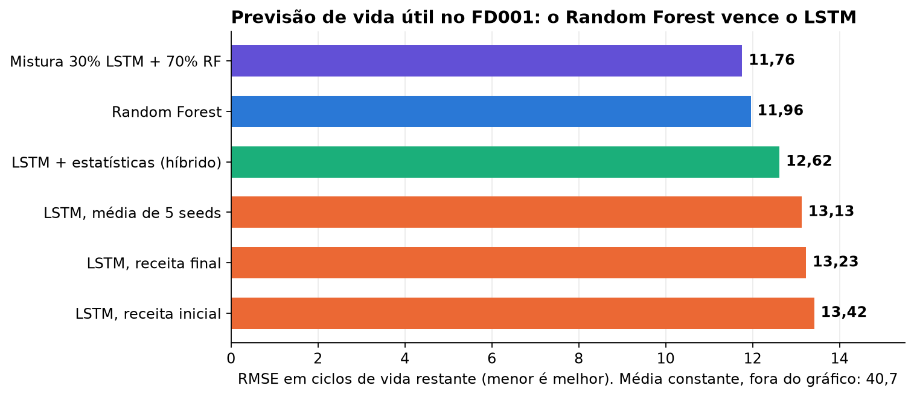
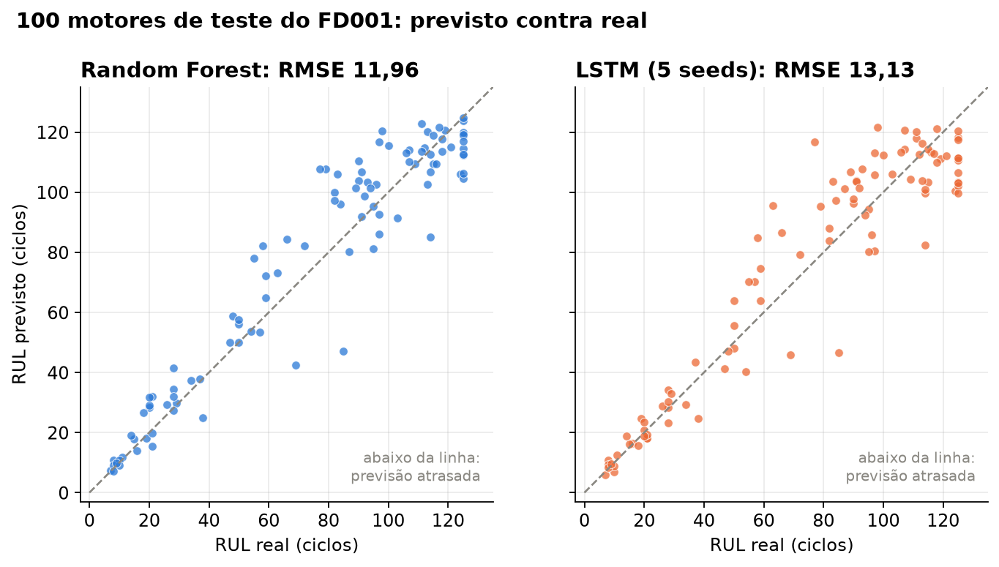
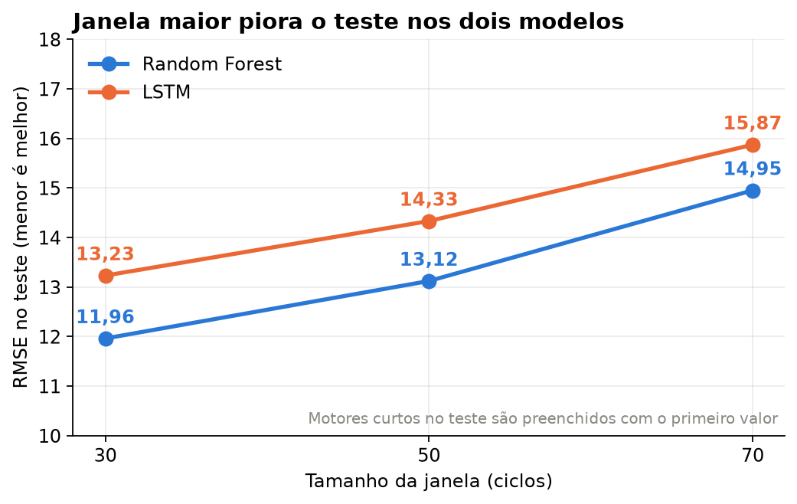
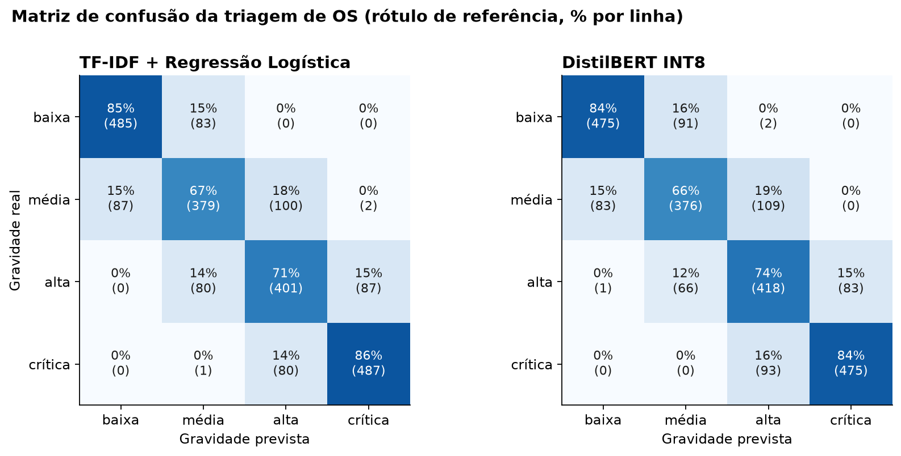
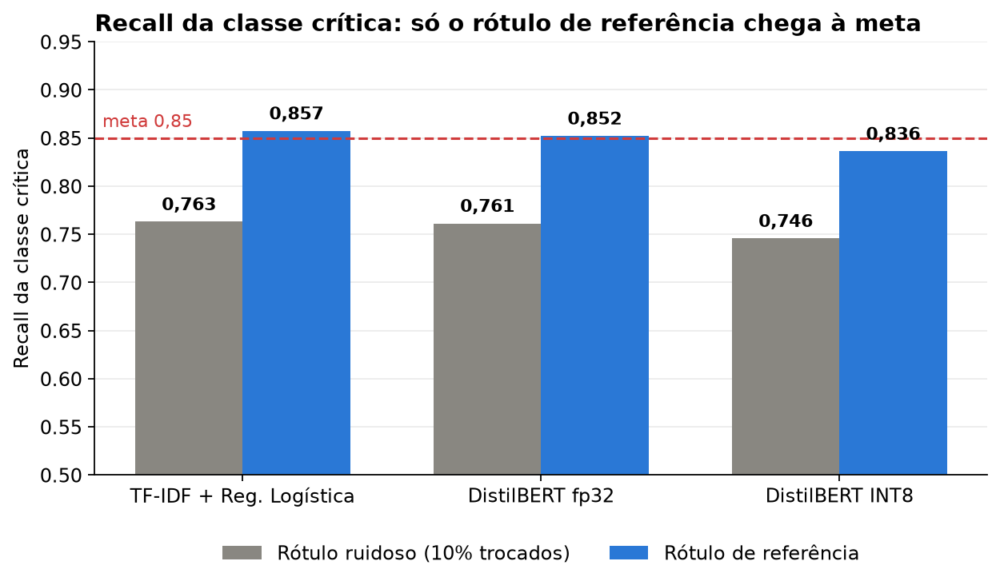
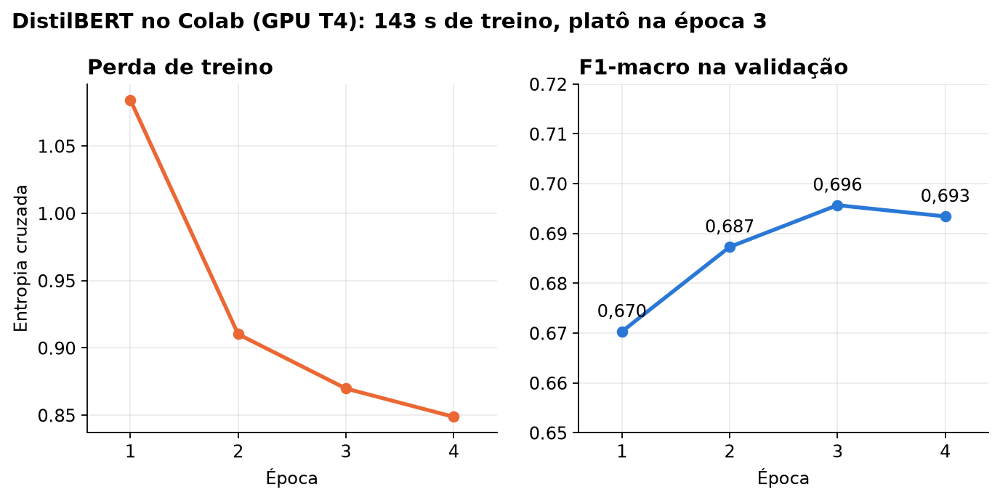
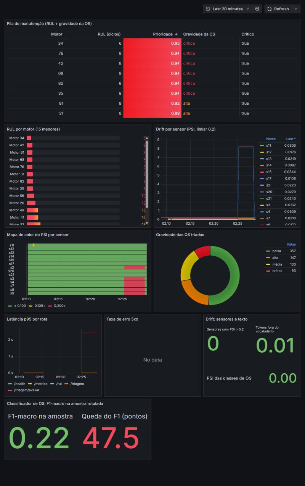
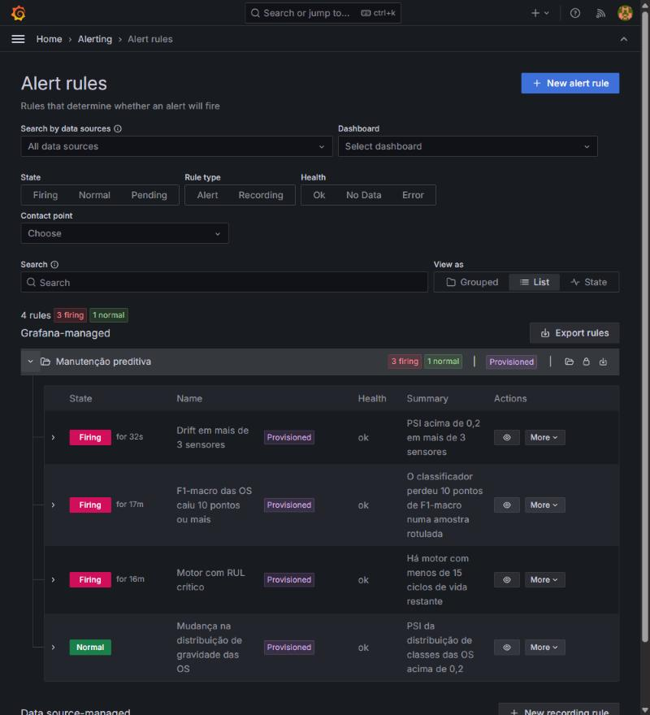
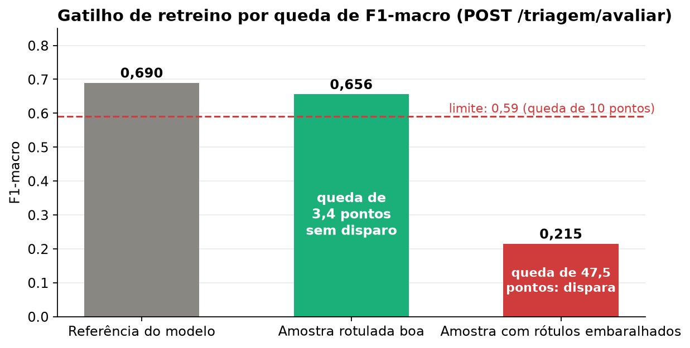

[🇧🇷 Português](README.md) | 🇺🇸 English

<div align="center">

# 🔧 Predictive Maintenance 4.0

### *A single maintenance queue that combines the remaining useful life of engines (LSTM) with the severity of work orders (NLP)*

[](https://www.python.org/)
[](https://keras.io/)
[](https://scikit-learn.org/)
[](https://spacy.io/)
[](https://onnxruntime.ai/)
[](https://fastapi.tiangolo.com/)
[](https://prometheus.io/)
[](https://grafana.com/)
[](https://www.docker.com/)

**A predictive maintenance system built to estimate how long each engine will last, understand what operators write in work orders, and turn both signals into a ranked list of who to service first, with drift monitoring and retraining alerts.**

</div>

---

## 🌟 Main Features

### 1. 🥉 Medallion Architecture — Bronze → Silver → Gold

Data goes through separate layers, and the later layers can be rebuilt without touching the original files.

* **Bronze:** original **NASA C-MAPSS** files copied byte for byte, with checksums (`MANIFEST.json`). The pipeline fails if any original changes.
* **Silver:** **Parquet** with constant sensors removed (detected from the training variance), RUL computed with a cap of 125 cycles, and Min-Max scaling fitted **on the training set only** (per operating-condition cluster in FD002 and FD004, using K-Means).
* **Gold:** sliding windows of 30 cycles in `.npz`, with the train/validation split made **per engine** (never per row), so a window from the same engine cannot leak across the split.

### 2. 📉 Remaining Useful Life with an LSTM

A two-layer LSTM (64 and 32 units, 33,185 parameters) reads a 30-cycle window of 14 sensors and returns the RUL.

* Mandatory baselines next to it: constant mean and a **Random Forest** on window statistics.
* **RMSE** and the **asymmetric NASA Score**, which punishes late predictions more than early ones ([see the difference](docs/METRICAS.md), in Portuguese).
* Export to **ONNX** (0.32 MB), within 8.4e-5 of Keras.
* Honest result: on FD001 the Random Forest beats the LSTM, after five attempts to improve it.
* The theory (hidden state, shared weights, BPTT, vanishing gradient) is in [docs/TEORIA_LSTM.md](docs/TEORIA_LSTM.md), in Portuguese.

### 3. 📝 Work Order Triage with NLP

There is no public Portuguese dataset of work orders, so the project **generates the corpus** from templates tied to each engine's real RUL (11,344 orders with abbreviations, typos, ambiguous symptoms and 10% of labels deliberately flipped).

* Rule-based **NER** (spaCy `EntityRuler`): part code (`HPC-0412`) in 100% of orders, plus component and symptom.
* Severity classification on four levels: low, medium, high and critical.
* Models: **TF-IDF + Logistic Regression** (baseline), a multilingual **DistilBERT** trained on Colab and exported to **ONNX INT8** (135.7 MB), **Word2Vec** for similar orders and **LDA** for topics.
* Edge cases: an empty order, one with only a part code, or one in another language returns `gravidade=indefinida` and goes to human review.

### 4. 🔀 Fusion and Maintenance Queue

A business rule, with weights in `configs/fusion.yaml`, combines the two modules into a priority score from 0 to 1:

```
priority = 0.6 · (1 − min(RUL, 125) / 125) + 0.4 · P(severity ∈ {high, critical})
```

The queue sorted by this score is what the dashboard shows. It is not a trained model, and the documentation says so.

### 5. 🚀 Inference Service — FastAPI + ONNX Runtime

* Endpoints: `/rul`, `/triagem`, `/triagem/avaliar`, `/prioridade`, `/drift`, `/metrics` and `/health`.
* **777 MB** Docker image, no PyTorch, running on CPU. Triage with DistilBERT takes **33 ms** (p95, over HTTP) and the API uses **365 MB** of RAM.
* Invalid input returns `422`. An engine with fewer than 30 cycles returns `low_confidence=true`, and an operating condition never seen in training is flagged instead of being predicted silently.

### 6. 📊 Monitoring, Drift and Alerts — Prometheus + Grafana

* **Grafana is provisioned from files**: data sources, the dashboard (9 panels) and **4 alerts** live in the repository, with no manual setup in the UI.
* **Sensor drift:** PSI against a sample of the training data. The trigger is PSI above 0.2 on **more than 3 sensors**.
* **Text drift:** out-of-vocabulary rate and PSI of the severity distribution.
* **Retraining trigger:** `POST /triagem/avaliar` receives orders with the true severity and fires when the macro F1 drops **10 points or more** below the training value.
* Metrics only use the labels `unit_id`, `sensor` and `gravidade`, never work-order text.

### 7. 🧪 Automated Tests and CI

* **112 automated tests**: data logic, no leakage between train and validation, API contract (`422` responses), edge cases, metrics, drift and F1 triggers, and the DistilBERT pipeline with a tiny model.
* Tests that check the Grafana files against the metrics the API exposes, and that every `make` command cited in the docs exists.
* **GitHub Actions** with `ruff`, `pytest` and a Docker image build.

---

## 🏗️ Architecture

The system has two independent modules that meet at the fusion step. The service loads only ONNX models and exposes metrics to Prometheus, and Grafana reads the metrics and the priority queue.



The main flow can be summarized as:

**Sensors + Work orders → Models (ONNX) → Fusion → Priority queue → Grafana**

There is also a design for running the same container on a gateway inside the factory, described as a proposal (not tested on hardware) in [docs/ARQUITETURA.md](docs/ARQUITETURA.md), in Portuguese.

---

## 📊 Results

All charts below are generated by `make graficos` from the files in [`docs/resultados/`](docs/resultados/).

### Engine remaining useful life (FD001)

<div align="center">



<p><em>The Random Forest (11.96) beats the LSTM (13.13 to 13.42). The constant mean errs by 40.7 and is off the chart.</em></p>

</div>

<div align="center">



<p><em>Predicted against true on the 100 test engines. Both models follow the diagonal; the LSTM scatters more on healthy engines.</em></p>

</div>

<div align="center">



<p><em>Larger windows make the test worse for both models, because short engines are padded with their first value.</em></p>

</div>

### Work order triage

<div align="center">



<p><em>Errors concentrate between neighboring severities. Low and critical are almost never confused.</em></p>

</div>

<div align="center">



<p><em>DistilBERT ties with TF-IDF on this synthetic corpus. The 0.85 target is only reached on the reference label.</em></p>

</div>

<div align="center">



<p><em>DistilBERT trained on a Colab T4 GPU in 143 seconds, plateauing at the third epoch.</em></p>

</div>

| Model | Macro F1 (noisy) | Macro F1 (reference) | Critical recall (noisy) | Critical recall (reference) |
|---|---|---|---|---|
| TF-IDF + Logistic Regression | 0.693 | 0.771 | 0.763 | 0.857 |
| DistilBERT fp32 | 0.696 | 0.773 | 0.761 | 0.852 |
| DistilBERT INT8 (used in the service) | 0.690 | 0.768 | 0.746 | 0.836 |

"Noisy" is the label a real system would see (10% deliberately flipped). "Reference" is the severity derived from the RUL, with no flips.

### Monitoring in Grafana

<div align="center">



<p><em>The dashboard after a forced drift episode: the PSI spike shows in the history and the heatmap shows the 6 shifted sensors in red. The queue at the top ranks engines by priority.</em></p>

</div>

<div align="center">



<p><em>The alerts loaded from files: during the incident, sensor drift, critical RUL and the F1 drop fired at the same time.</em></p>

</div>

<div align="center">



<p><em>The retraining trigger measured in the container: a good sample dropped 3.4 points (no trigger) and a sample with shuffled labels dropped 47.5 points (fires).</em></p>

</div>

Full numbers, technical decisions and what was verified at each stage are in [docs/RESULTADOS.md](docs/RESULTADOS.md), in Portuguese.

---

## ⚡ Quickstart

### 1. Set Up the Environment

The project uses [`uv`](https://github.com/astral-sh/uv) and Python 3.12. `make` is a convenience, but the `uv run` commands in the `Makefile` also work by hand.

```bash
git clone https://github.com/samuelmel/manutencao-preditiva-.git
cd manutencao-preditiva-

make install
```

Or without `make`:

```bash
uv venv --python 3.12 .venv
uv pip install --python .venv -e ".[dev,train,nlp,serve,bert,docs]"
```

### 2. Download the Data

Download NASA's C-MAPSS ([CMAPSSData.zip](https://data.nasa.gov/docs/legacy/CMAPSSData.zip)) and copy `train_FD00x.txt`, `test_FD00x.txt` and `RUL_FD00x.txt` into `data/raw_download/`. The `data/` folder is not versioned.

### 3. Run the Full Pipeline

```bash
make reproduce
```

The command chains `make data` (bronze, silver and gold), `make train-rul` (baselines and LSTM, exports the ONNX), `make text` (generates the orders, NER, TF-IDF, Word2Vec and LDA) and `make serving` (gathers the artifacts the API loads). Seeds are fixed.

DistilBERT is trained separately on Colab: `make colab` builds a 1.2 MB zip and the notebook `notebooks/treinar_distilbert.ipynb`. Without it, the API uses TF-IDF.

### 4. Start the Infrastructure

```bash
make up                                  # Docker
make up COMPOSE="podman compose"         # Podman
```

After startup:

* **API (interactive docs):** `http://127.0.0.1:8000/docs`
* **Prometheus:** `http://127.0.0.1:9090`
* **Grafana:** `http://127.0.0.1:3000`

Default credentials for the local environment:

```text
Grafana
User: admin
Password: admin    (change it with the GRAFANA_ADMIN_PASSWORD variable)
```

> Ports are bound to `127.0.0.1` and the password above is for local development only. The first time, Grafana takes a few minutes to migrate its database and download the Infinity plugin.

### 5. Fill the Dashboards with Simulated Traffic

```bash
make simular                              # 100 test engines and one order for each
uv run python -m mp.simular --drift       # shifts 6 sensors and fires the drift alert
uv run python -m mp.simular --f1-degradado  # labeled sample with shuffled labels
```

---

## 💻 API Usage Examples

### Triage of a work order

> On Windows, Git Bash's `curl` can mangle accents in the request body and the API answers `400`. Use PowerShell, Python or the `/docs` interface.

```bash
curl -X POST http://127.0.0.1:8000/triagem \
  -H "Content-Type: application/json; charset=utf-8" \
  -d '{"texto": "Motor 5: falha total em compressor de alta (HPC-0412), fumaça visível.", "unit_id": 5}'
```

```json
{
  "entidades": {
    "codigo": "HPC-0412",
    "componente": "compressor de alta",
    "sintoma": "fumaça visível"
  },
  "texto_limpo": "motor 5: falha total em compressor de alta (hpc-0412), fumaça visível.",
  "gravidade": "crítica",
  "motivo": null,
  "probabilidades": { "baixa": 0.034, "média": 0.022, "alta": 0.183, "crítica": 0.76 },
  "p_grave": 0.944,
  "revisao_humana": false
}
```

Text in another language, empty text or text with only a part code is not classified:

```json
{ "gravidade": "indefinida", "motivo": "vocabulário desconhecido", "p_grave": null, "revisao_humana": true }
```

### Maintenance queue

```bash
curl "http://127.0.0.1:8000/prioridade?top=3"
```

```json
{
  "itens": [
    { "unit_id": 34, "rul": 5.7, "p_grave": 0.936, "gravidade_os": "crítica", "prioridade": 0.947, "critico": true },
    { "unit_id": 76, "rul": 7.7, "p_grave": 0.945, "gravidade_os": "crítica", "prioridade": 0.941, "critico": true },
    { "unit_id": 42, "rul": 7.6, "p_grave": 0.94,  "gravidade_os": "crítica", "prioridade": 0.94,  "critico": true }
  ]
}
```

### Classifier retraining trigger

Send orders with their true severity and the API compares the macro F1 with the model's reference value:

```bash
curl -X POST http://127.0.0.1:8000/triagem/avaliar \
  -H "Content-Type: application/json; charset=utf-8" \
  -d '{"itens": [{"texto": "Operador relata travamento do eixo em turbina de alta, peça HPT-0185.", "gravidade": "crítica"}, ...]}'
```

```json
{
  "n_amostra": 300, "n_avaliadas": 300, "n_indefinidas": 0,
  "f1_macro": 0.656, "f1_macro_ref": 0.69, "queda_pontos": 3.399, "limite_pontos": 10,
  "amostra_pequena": false, "gatilho_retreino": false
}
```

### An engine's remaining life

`POST /rul` takes the `unit_id` and the list of cycles (each cycle is an object with `op1`, `op2`, `op3` and the 14 sensors). With fewer than 30 cycles the response carries `low_confidence=true`, and a negative RUL is clipped to zero.

---

## 💻 Code Example — Fusion and PSI

The fusion lives in `src/mp/fusion.py` and is a pure function, easy to test:

```python
def prioridade(rul: float, p_grave: float | None, w_rul: float = 0.6, w_os: float = 0.4,
               rul_cap: float = 125.0) -> float:
    """Em [0, 1]. Sem OS conhecida (`p_grave=None`) a parcela da OS vale 0."""
    rul = min(max(float(rul), 0.0), rul_cap)
    parcela_os = 0.0 if p_grave is None else min(max(float(p_grave), 0.0), 1.0)
    return w_rul * (1.0 - rul / rul_cap) + w_os * parcela_os
```

Sensor drift uses PSI, with bins taken from quantiles of the reference (`src/mp/drift.py`, shortened here):

```python
def psi(ref: np.ndarray, atual: np.ndarray, bins: int = 10) -> float:
    """Population Stability Index com faixas por quantis da referência."""
    ref, atual = np.asarray(ref, dtype=float), np.asarray(atual, dtype=float)
    edges = np.unique(np.quantile(ref, np.linspace(0, 1, bins + 1)))
    if len(edges) < 3:  # sensor praticamente constante na referência
        return 0.0 if np.allclose(atual, ref[0]) else float("inf")
    edges[0], edges[-1] = -np.inf, np.inf
    p = np.histogram(ref, edges)[0] / len(ref)
    q = np.histogram(atual, edges)[0] / len(atual)
    p, q = np.clip(p, 1e-4, None), np.clip(q, 1e-4, None)
    return float(np.sum((q - p) * np.log(q / p)))
```

---

## 🧪 Automated Tests

```bash
make test
```

Or directly:

```bash
uv run pytest -q
```

The tests that use the real artifacts (RMSE through the API, latency, DistilBERT) are skipped if `make reproduce` has not run yet.

---

## 🗂️ Repository Structure

```
src/mp/
  ingest/       bronze: file reading and checksums
  transform/    silver and gold: RUL, scaling, windows
  textgen/      synthetic work order generator
  nlp/          cleaning, NER, Word2Vec and LDA
  models/       LSTM, baselines, text classifiers
  api/          FastAPI service and Prometheus metrics
  fusion.py     combined priority
  drift.py      PSI and KS
configs/        parameters (data, fusion, triggers)
grafana/        versioned data sources, dashboard and alerts
prometheus/     scrape configuration
docker/         API Dockerfile
notebooks/      DistilBERT training on Colab
scripts/        chart, dashboard and Colab package generation
docs/           theory, metrics, architecture and results
img/            charts and Grafana screenshots
tests/          112 tests
```

---

## 📚 Documentation

The documents below are in Portuguese.

* [README-PROCESSO.md](README-PROCESSO.md): how the project was built, what went wrong and what changed along the way.
* [docs/RESULTADOS.md](docs/RESULTADOS.md): numbers, technical decisions and verifications.
* [docs/TEORIA_LSTM.md](docs/TEORIA_LSTM.md): how the LSTM works, without advanced math.
* [docs/METRICAS.md](docs/METRICAS.md): RMSE, NASA Score, F1, PSI, KS and bootstrap.
* [docs/ARQUITETURA.md](docs/ARQUITETURA.md): system diagram and edge design.

## 🚧 Limitations and Next Steps

* The work order text is **synthetic**. No triage result counts as evidence about real work orders, and only real orders could show whether DistilBERT is worth its cost over TF-IDF.
* The LSTM was trained and served for **FD001** only. The comparison with the Random Forest on FD002 to FD004, which have several operating conditions, has not been done yet.
* The maintenance queue lives in the API's memory, so restarting the API empties it.
* The image was built for amd64 only, and the factory-gateway design was not tested on hardware.
* The final models were not published as GitHub Releases, and experiments are not tracked in MLflow.
* **Maybe later:** anomaly detection on images (MVTec AD) and on machine audio (MIMII), and summaries generated by a language model. The audio data alone needs 7 to 11 GB files per machine type, which is over the project's disk budget.

---

**Samuel Santos**

This project was developed as a **technical portfolio and study project**, focused on Data Engineering, MLOps, CPU inference architectures and production model monitoring.

Sensor data comes from the NASA Prognostics Data Repository (C-MAPSS). The text classifier starts from Hugging Face's `distilbert-base-multilingual-cased`, and the NER uses spaCy's `pt_core_news_sm`.

---

[🇧🇷 Português](README.md) | 🇺🇸 English
