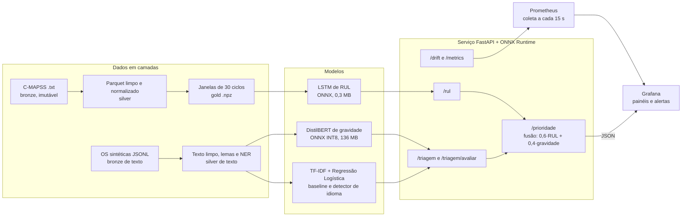
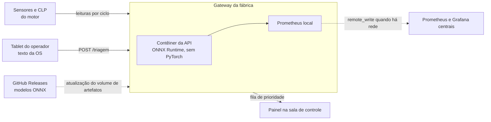

# Arquitetura

## Visão geral

Dois módulos independentes (vida útil de motores e triagem de ordens de serviço) alimentam uma fila única de
manutenção. O serviço roda só com ONNX Runtime, sem PyTorch, e o que ele faz fica visível no Prometheus e no Grafana.

## Por camadas

Dados (medalhão). O bronze guarda os arquivos originais sem alterar (o pipeline confere checksums). O silver tem
o dado limpo: sensores constantes removidos, RUL calculado com teto de 125, normalização Min-Max ajustada só no
treino (por grupo de condição de operação no FD002 e no FD004). O gold tem as janelas deslizantes prontas para o
modelo. A divisão entre treino e validação é sempre por motor, nunca por linha, para uma janela do mesmo motor não
vazar de um lado para o outro.

Texto. Não existe base pública de OS em português, então o projeto gera as ordens por templates a partir do RUL
real do C-MAPSS, com ruído de chão de fábrica. Quem lê os resultados precisa saber disso: o texto é sintético.

Fusão. `prioridade = 0,6 · (1 − min(RUL, 125) / 125) + 0,4 · P(gravidade ∈ {alta, crítica})`. É uma regra de
negócio, com pesos em `configs/fusion.yaml`, e não um modelo treinado.

Observabilidade. A API expõe métricas com rótulos só de `unit_id`, `sensor` e `gravidade` (nunca texto de OS, para
não explodir a cardinalidade). O Grafana é provisionado por arquivo: fontes, dashboard e alertas ficam no repositório,
e nada é configurado pela interface.

Treino. O LSTM e o baseline TF-IDF treinam no computador local. O DistilBERT treina no Colab (GPU) por um notebook
que só chama o pacote `src/mp`. Os artefatos finais (ONNX e tokenizer) vão para `artifacts/serving`, que o contêiner
monta como volume.

## Desenho para borda (edge)

> Estado: este é um desenho, não algo testado em hardware de fábrica. O que foi verificado é o contêiner em
> amd64 (Podman no Windows). O restante é a consequência de decisões que já tomamos.

A ideia é rodar o mesmo contêiner num gateway dentro da fábrica, perto dos motores, em vez de mandar leituras
para uma nuvem.

Por que o desenho se sustenta:

- Sem PyTorch na imagem. A imagem tem 777 MB e o serviço carrega só ONNX Runtime, `tokenizers` e scikit-learn. A
  inferência roda em CPU, sem GPU. Medido no contêiner depois de 400 requisições: a API usa 365 MB de RAM com o
  DistilBERT, o LSTM e o TF-IDF carregados, e o Prometheus local usa 24 MB.
- Latência baixa e local. Em CPU, `/rul` fica abaixo de 50 ms e `/triagem` com o DistilBERT leva 33 ms (p95, via
  HTTP, no contêiner). Não há ida e volta até a nuvem.
- Funciona sem internet. A API não chama nenhum serviço externo. Se a rede cair, a fila continua sendo calculada e
  o Prometheus local guarda as métricas até a conexão voltar.
- Os dados ficam na fábrica. Leituras de sensor e texto das OS não saem do gateway; só as métricas agregadas
  sobem, se alguém quiser.
- Atualizar o modelo é trocar arquivos. Os modelos ficam num volume somente leitura (`artifacts/serving`). Para
  atualizar, baixa-se o novo `.onnx` da Release e reinicia-se o contêiner, sem reconstruir a imagem.

O que falta para sair do papel:

- Construir a imagem para arm64, se o gateway for ARM (Raspberry Pi, Jetson). `onnxruntime`, `tokenizers`,
  `scikit-learn` e `pyarrow` publicam pacotes para essa arquitetura, mas isso não foi testado aqui.
- A fila de prioridade fica em memória: reiniciar o contêiner a esvazia até chegarem novas leituras. Num gateway
  real seria preciso persistir esse estado (um arquivo SQLite resolve).
- Repetir a medida de memória e CPU no hardware escolhido (os 365 MB acima são de um PC x86 com Podman).
- Definir quem alimenta o `/rul` (um agente no CLP, um coletor MQTT) e como a OS chega do tablet. O serviço só expõe a
  API HTTP.
